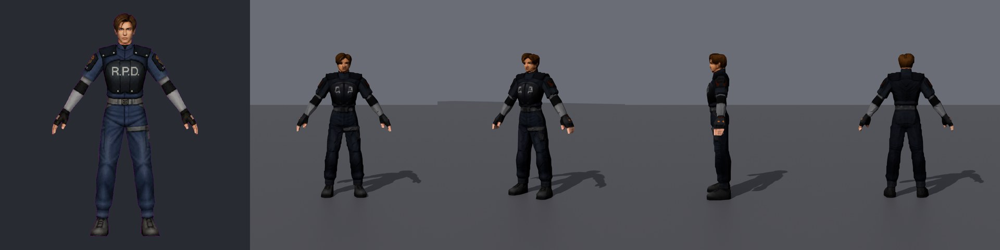
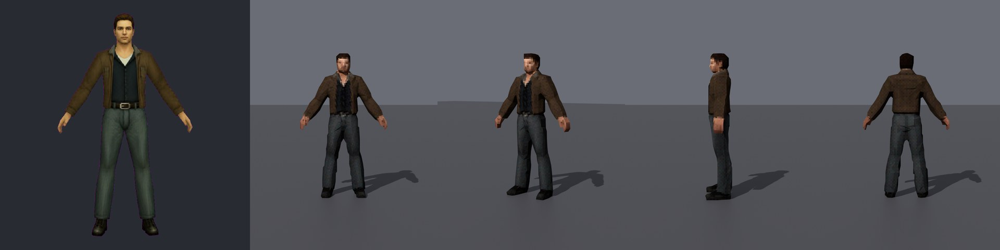
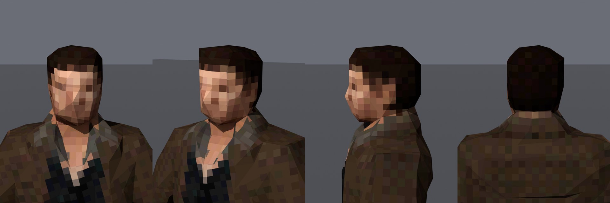
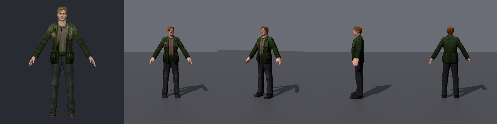
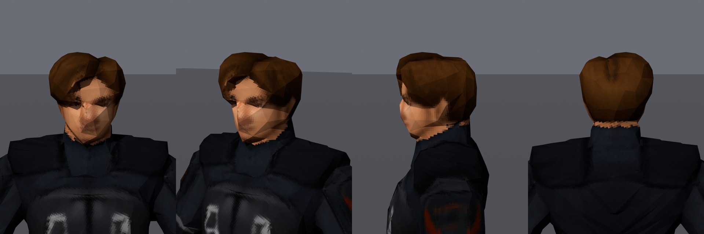
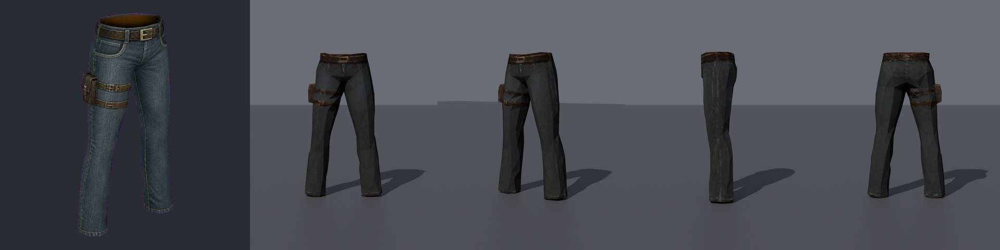

# mesh-generator – image → PS1/PS2-style 3D model

One image → a finished, textured, low-poly 3D model (GLB) in the style of PS1/PS2-era games. Everything runs on
your own machine (TRELLIS.2 or TripoSR + Blender, in Docker or installed locally), and every component is free for
commercial use.


*Reference image (left) → the model from the front, three-quarter, side and back. TRELLIS.2, 2998 triangles,
512 px atlas.*

```
python scripts/pipeline.py image.png out --kind character --triangles 3000 --texture 512
```

`out/model.glb` is the finished model: real size in meters, standing on the ground, one texture atlas. Next to it:

- the check pictures (`out/check/`);
- the high-res mesh (`out/hires.glb` – reuse it with `--hires` to repeat or tweak the result without generating
  again);
- `out/report.json`, with every setting, measurement and ok / warn / fail verdict.

## With Claude Code

Open this folder in Claude Code and ask, for example: *"make a PS2 character from this image: C:\…\image.png"*.
`CLAUDE.md` gives it the steps, the options, the rules and the expected result, and it checks the model itself at
the end.

## Results

**PS1 budget:** TRELLIS.2, 1000 triangles, 128 px atlas, 15-bit color with dither.




**PS2 budget:** TRELLIS.2, 3000 triangles, 512 px atlas.




**An object:** TRELLIS.2, 800 triangles, 256 px atlas, 1.05 m.



The demos ran on an RTX 3060 (12 GB VRAM), where TRELLIS.2 took 3–5 minutes per model. Known weakness: TRELLIS.2
often makes colors darker and less saturated than the reference (Leon's blue uniform, the denim).

## You need

- Python 3.10+ (no packages);
- **Docker Desktop + an NVIDIA GPU** (recommended; the images build themselves on first use);
- or without Docker: Blender 4.5+, `pip install pillow numpy`, and your own TRELLIS.2 or TripoSR install
  (`--mode local`).

Details, all options and troubleshooting are in [CLAUDE.md](CLAUDE.md).

## Licenses

- **TRELLIS.2, CuMesh, FlexGEMM, TripoSR:** MIT.
- **The DINOv3 encoder:** DINOv3 License (commercial use OK, "Built with DINOv3").
- **Blender:** GPL; it runs as a separate program.
- **Left out on purpose:** non-commercial parts (RMBG-2.0, nvdiffrast) and Hunyuan3D.
- **The demo characters** belong to their publishers. They are shown here only as test results; the models
  themselves are not in the repository.
