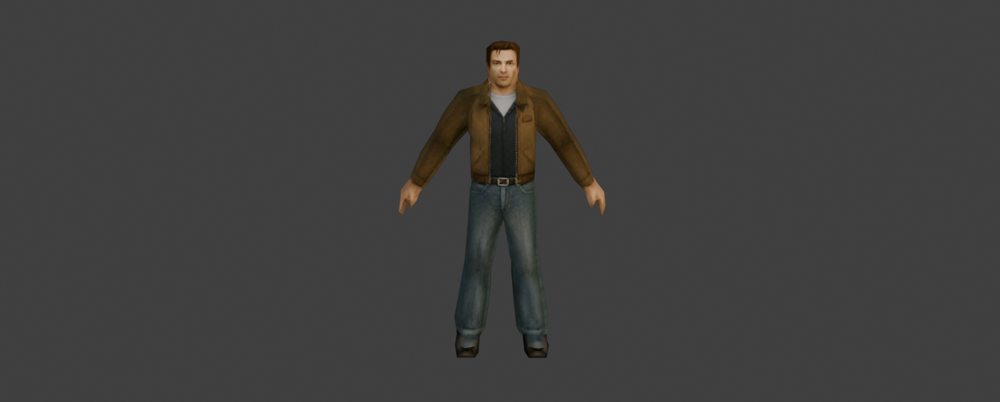

# mesh-generator – image → PS1/PS2-style 3D model

One image → a finished, textured, rigged, low-poly 3D model (GLB) in the style of PS1/PS2-era games. Everything runs
on your own machine (TRELLIS.2 or TripoSR + Blender, in Docker or installed locally), and every component is free for
commercial use.

```
python scripts/pipeline.py image.png out --kind character --triangles 3000 --texture 512
```

**On Windows, just drag the image onto `generate.cmd`.** It runs the whole pipeline into `out\<image name>\`,
shows the verdicts, and opens the check pictures and the folder. `generate.ps1 image.png -Texture 256 -Ps1 ...`
takes the options too (`-Kind`, `-Triangles`, `-Height`, `-Hires`, `-NoRig`, `-NoProject`). `out/` is git-ignored.

`out/model.glb` is the finished model: real size in meters, standing on the ground, one texture atlas. For
characters, `out/model_rigged.glb` is the same model with a humanoid skeleton, skin weights and two basic clips
(`idle-loop`, `walk-loop`). Next to them:

- the check pictures (`out/check/`);
- the high-res mesh (`out/hires.glb` – reuse it with `--hires` to repeat or tweak the result without generating
  again);
- `out/report.json`, with every setting, measurement and ok / warn / fail verdict.

**No image yet?** Run `prompt.cmd` (or `prompt.ps1 -Kind character -Description "..."`): it asks what you want
and makes the prompt for an image model (gpt-image, Flux, SDXL, …), copied to the clipboard, so the image comes
out the way this kit needs it: front view, A-pose, flat light, plain background. The whole texture of the model
is baked from that picture.

## With Claude Code

Open this folder in Claude Code and ask, for example: *"make a PS2 character from this image: C:\…\image.png"*.
`CLAUDE.md` gives it the steps, the options, the rules and the expected result, and it checks the model itself at
the end.

## Notes

- The reference image is projected onto the front of the model at the resolution of the photo (`--texture 2048`);
  the back and the sides are the generator's guess (see `CLAUDE.md`, "Faults").
- TRELLIS.2 ran in its 512 mode on an RTX 3060 (12 GB VRAM) and took 3–15 minutes per model. Known weakness: it often
  makes colors darker and less saturated than the reference.
- **Optional:** after a run, `ai.cmd` opens the model in a Blender window and lets an AI agent (Claude Code or Codex)
  edit it through Blender MCP ("put THIS picture on her face"). Your prompts and pictures then go to the agent's
  provider; the generation itself stays local. See `CLAUDE.md`.

## You need

- **Docker Desktop + an NVIDIA GPU** (recommended; the images build themselves on first use), and a Python 3.10+
  with no packages (a portable one: `setup.ps1 -Python`). Everything else runs in Docker, so the host stays clean:
  [install.md](install.md), checked by `setup.ps1`;
- or without Docker: Blender 4.5+, `pip install pillow numpy`, and your own TRELLIS.2 or TripoSR install
  (`--mode local`).

Details, all options and troubleshooting are in [CLAUDE.md](CLAUDE.md).

## Licenses

- **TRELLIS.2, CuMesh, FlexGEMM, TripoSR:** MIT.
- **The DINOv3 encoder:** DINOv3 License (commercial use OK, "Built with DINOv3").
- **Blender:** GPL; it runs as a separate program.
- **Left out on purpose:** non-commercial parts (RMBG-2.0, nvdiffrast) and Hunyuan3D.
- **The demo characters** belong to their publishers. They are shown here only as test results; the models
  themselves are not in the repository.
